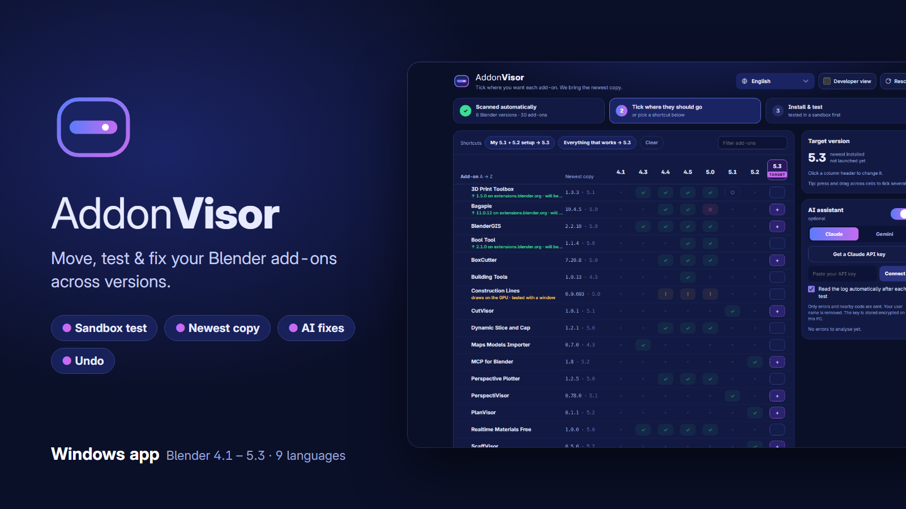
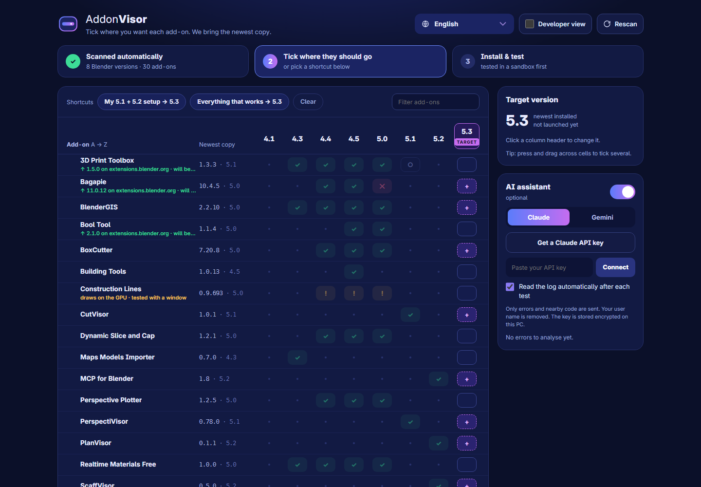
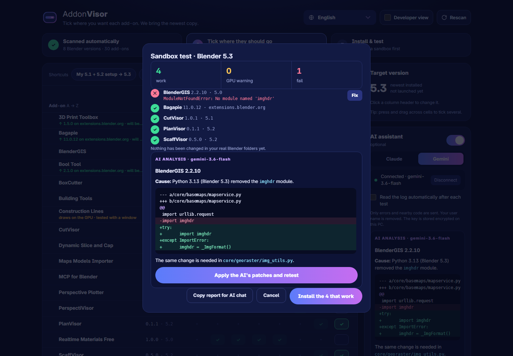
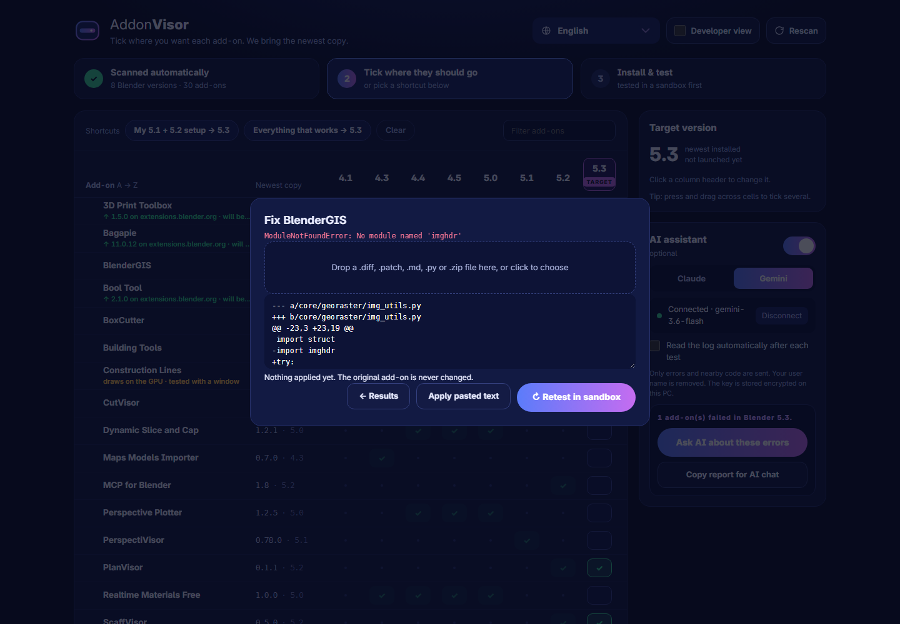

# AddonVisor

**Move, test and fix your Blender add-ons across versions — outside Blender.**

New Blender version, and half your add-ons are gone or broken? AddonVisor finds every Blender installed on
your PC, shows which add-ons you use in each one, copies them to the new version, **tests them in a sandbox
first**, and tells you exactly what breaks and why — with a fix when there is one.

## What it does

- **Sees all your Blender versions at once** — Program Files, Steam, portable installs; even versions you
  have never opened.
- **One matrix, A → Z.** Rows are add-ons, columns are Blender versions. Tick the cells where you want an
  add-on (click, or drag across several), or use a shortcut like *"My 5.1 + 5.2 setup → 5.3"*.
- **Always the newest copy.** It finds every copy of each add-on on your PC and uses the newest one that
  supports the target. If **extensions.blender.org** has a newer compatible version, it downloads that instead.
- **Sandbox test before anything changes.** Your add-ons are installed and enabled in a throw-away copy of the
  target's settings. You see what works and what fails — with the real Python error — before your real Blender
  is touched. GPU add-ons are retested with a window automatically.
- **Install only what works, with Undo.** Backup before every install; one click puts everything back.
- **Fix what fails, on a copy.** Drop a patch from any AI (Claude, ChatGPT, Gemini…), a whole AI answer,
  a fixed `.py` or a `.zip`, then retest. Every patch can be removed one by one.
- **Optional AI assistant.** Connect Gemini (free key, Google sign-in), Claude, or a local AI on your PC (Ollama, LM Studio) and it reads the error log
  for you and proposes the fix.
- **9 languages:** English, Français, Español, Deutsch, Русский, 简体中文, 日本語, Português (Brasil), Română.

  
  

## Get it

AddonVisor costs **$10** — one payment, free updates for 1.x.

- **Gumroad:** [link coming soon]
- **Superhive:** [link coming soon]

Windows 10/11 64-bit. Tested with Blender 4.1 – 5.3.

## Help

📖 **User Guide: https://raduandrei-source.github.io/AddonVISOR/**
— also in [Français](https://raduandrei-source.github.io/AddonVISOR/fr/) ·
[Español](https://raduandrei-source.github.io/AddonVISOR/es/) ·
[Deutsch](https://raduandrei-source.github.io/AddonVISOR/de/) ·
[Русский](https://raduandrei-source.github.io/AddonVISOR/ru/) ·
[简体中文](https://raduandrei-source.github.io/AddonVISOR/zh/) ·
[日本語](https://raduandrei-source.github.io/AddonVISOR/ja/) ·
[Português (Brasil)](https://raduandrei-source.github.io/AddonVISOR/pt-br/) ·
[Română](https://raduandrei-source.github.io/AddonVISOR/ro/)

The same content as separate pages:

| | |
|---|---|
| [Getting started](docs/getting-started.md) | install, first scan, symbols, where files are kept |
| [Migrating add-ons](docs/migrating.md) | target, ticking, shortcuts, sandbox test, install, Undo |
| [Fixing add-ons](docs/fixing-addons.md) | patches from AI, retest, patch list, remove / reset |
| [AI assistant](docs/ai-assistant.md) | Gemini and Claude keys, what is sent |
| [Troubleshooting](docs/troubleshooting.md) | common problems and how to report one |
| [FAQ](docs/faq.md) | short answers |
| [Privacy](docs/privacy.md) | no telemetry; what goes over the network |
| [Changelog](CHANGELOG.md) | what's new |

Example patch: [`patches/BlenderGIS_2.2.10_python313_imghdr.diff`](patches/BlenderGIS_2.2.10_python313_imghdr.diff)
makes BlenderGIS 2.2.10 work in Blender 5.3.

## Support

Open an [issue](https://github.com/raduandrei-source/AddonVISOR/issues) or write to **gmcis.cutvisor@gmail.com**.
Please attach the newest `run_*.log` from `%LOCALAPPDATA%\AddonVisor\logs\`.

## License

AddonVisor is free software under the [GNU General Public License v3](LICENSE); buyers receive the full source
code with the download. "Blender" is a trademark of the Blender Foundation; AddonVisor is an independent tool and
is not affiliated with or endorsed by the Blender Foundation.

© 2026 Radu Andrei
